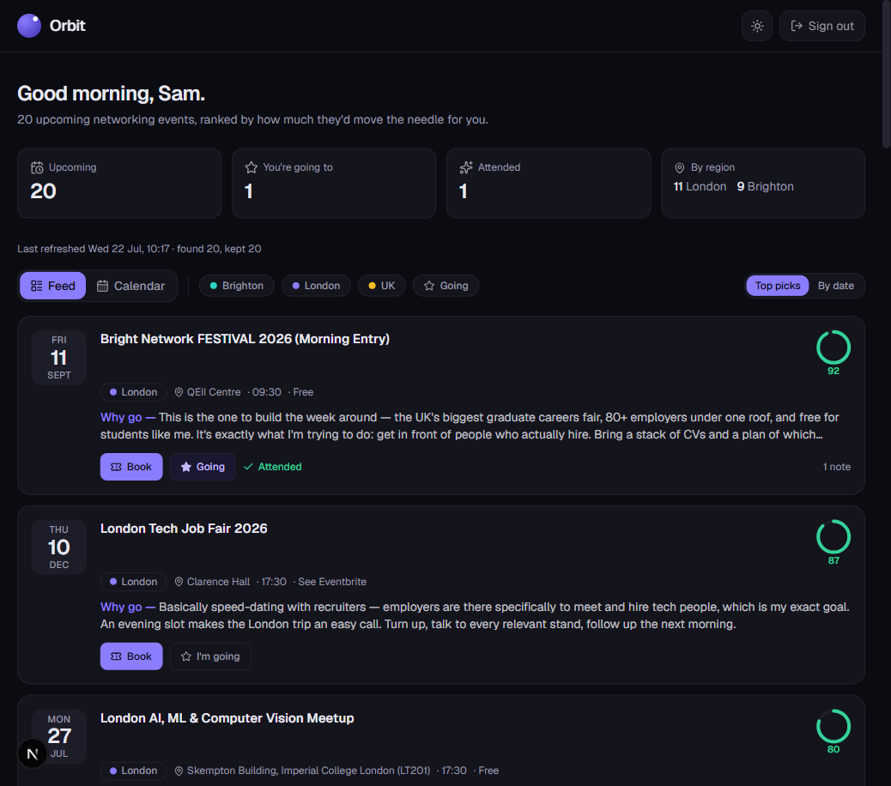
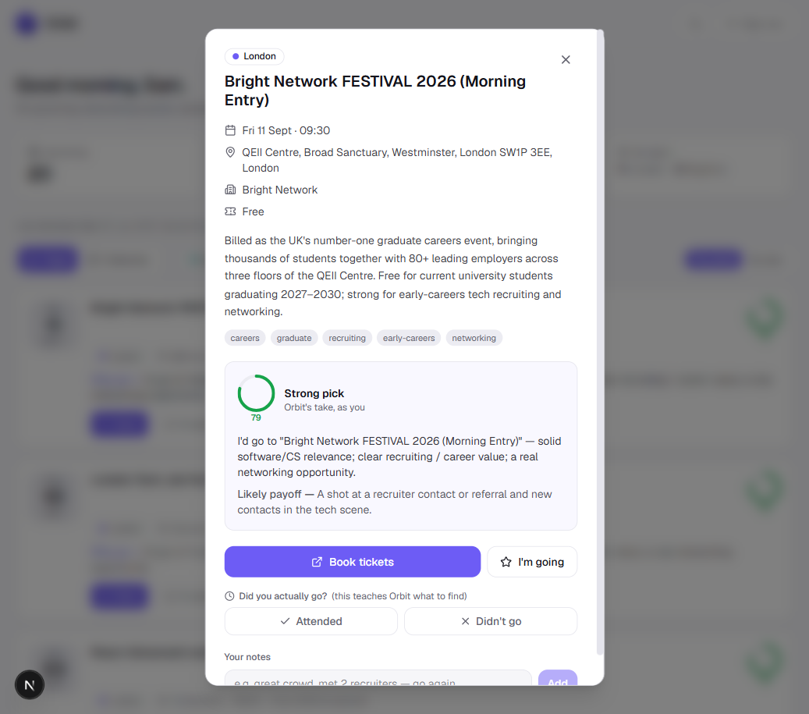

# Orbit

A private calendar that finds the **networking events actually worth your time** and ranks them as if it were you - so a graduate careers fair or a relevant hackathon rises to the top and a beginner meetup in the wrong city sinks. Built for a job-seeking CS student, but the persona is configurable.



## What it does

- **Finds events for you.** A local runner sweeps the web (via Claude's web-search) for in-person networking events across Brighton & Sussex, London, and the occasional high-value UK trip.
- **Ranks them as you.** Each event is scored 0-100 *in your shoes* - weighting hiring value, relevance to your field, and travel cost - with a short "why go" and the likely payoff.
- **Learns from you.** A ✓/✗ on whether you actually attended, plus free-text notes, feed back into the next run so the picks get sharper over time.
- **Puts them on your calendar.** Anything you mark "going" is pushed to your real Google Calendar, booking link attached.
- **Emails you a daily digest.** New finds + what's coming up, straight to your inbox.
- **Never misses days.** The runner detects and backfills any gap since its last successful run - so if your laptop was off for a week, one run catches you up.

## How it works

Three pieces meet at one database. The runner and the app never talk directly - they share Postgres - so the app works fine while the runner is offline, and vice-versa.

```
  LOCAL RUNNER (your laptop, Task Scheduler)      VERCEL APP (Next.js)
   • daily run + catch-up on boot                  • in-app calendar (feed + month)
   • Claude web-search discovery                   • tick/cross attendance
   • "imagine you're Sam" curation                 • notes per event
   • pushes "going" events -> Google Calendar      • booking links + "why go"
   • sends the daily digest email (as you)         • sign in with Google / password
            \                                            /
             \--------------->  POSTGRES  <-------------/
                     events · curations · attendance
                     notes · runs · profile · gcal_sync
```

### The "imagine you're Sam" brain

The curator runs with a persona (stored on the `profile` row) and your full history - every ✓/✗ and note. It ranks for *"will this get me a job, a referral, or a genuinely useful connection?"* With an Anthropic key it's a Claude call; without one it falls back to a transparent keyword/region/history heuristic so the pipeline still runs. The initial demo ships with hand-authored editorial verdicts so you can see the quality bar immediately.



## Tech stack

Next.js 16 (App Router, Server Actions) · React 19 · TypeScript · Tailwind v4 · Drizzle ORM + Postgres (Neon in prod) · Auth.js · Anthropic SDK (web search) · googleapis (Calendar + Gmail).

## Getting started (local)

Requires Node 20+ and Docker (for a local Postgres).

```bash
# 1. Postgres
docker run -d --name networking-cal-db \
  -e POSTGRES_PASSWORD=devpass -e POSTGRES_DB=networking_cal \
  -p 5434:5432 postgres:16

# 2. Env + deps
cp .env.example .env      # sane local defaults are already filled in
npm install

# 3. Schema + real seed data (20 genuine Brighton/London events)
npm run db:migrate
npm run db:seed

# 4. Run it
npm run dev               # http://localhost:3000  (dev password: "dev")
```

## Going live

Everything above works with **zero paid keys** (mock discovery + heuristic curation + a console-logged digest). To make it real, fill these into `.env`:

| Capability | Env | Notes |
|---|---|---|
| Real event discovery | `ANTHROPIC_API_KEY` | Runner uses Claude web-search instead of the mock provider. |
| Curation quality | `ANTHROPIC_API_KEY` | Same key; Claude ranks instead of the heuristic. |
| Calendar + email | `GOOGLE_CLIENT_ID` / `GOOGLE_CLIENT_SECRET` | One OAuth grant covers both. Then run `npm run google:auth` once to authorise (writes `runner/.google-token.json`). |
| Sign in with Google | same Google creds | The app shows a Google button; locked to `ALLOWED_EMAIL`. |

Deploy the **app** to Vercel (point `DATABASE_URL` at Neon). Schedule the **runner** on your laptop:

```powershell
# from the repo root, registers a daily 07:00 run + a catch-up at logon
powershell -ExecutionPolicy Bypass -File scripts/register-tasks.ps1
```

## Scripts

| Script | Does |
|---|---|
| `npm run dev` | Next.js dev server |
| `npm run db:migrate` | Apply Drizzle migrations |
| `npm run db:seed` | Load the 20 real seed events + editorial curation |
| `npm run runner` | One discovery run (daily) |
| `npm run runner:catchup` | Catch-up run (backfills missed days) |
| `npm run google:auth` | One-time Google OAuth for calendar + gmail |

## Project structure

```
app/            Next.js app - (app)/ is auth-gated; login/ is public
components/      UI (feed, calendar, event dialog, chrome)
db/             Drizzle schema, client, migrations
lib/            queries, serialization, shared runner<->app types
runner/         the local runner: discovery, curation, calendar, email, orchestrator
scripts/        Windows Task Scheduler setup
docs/           design spec + screenshots
```

## Status

The app and full pipeline are built and verified end-to-end against a local database (auth, ranked feed, month calendar, attendance ✓/✗, notes, live stats, calendar reconcile, digest email). Live discovery, Google Calendar push, and Gmail sending are implemented and activate when their keys are supplied - see *Going live*. The seed events are real and their booking links were checked at seed time (19/20 resolved).
